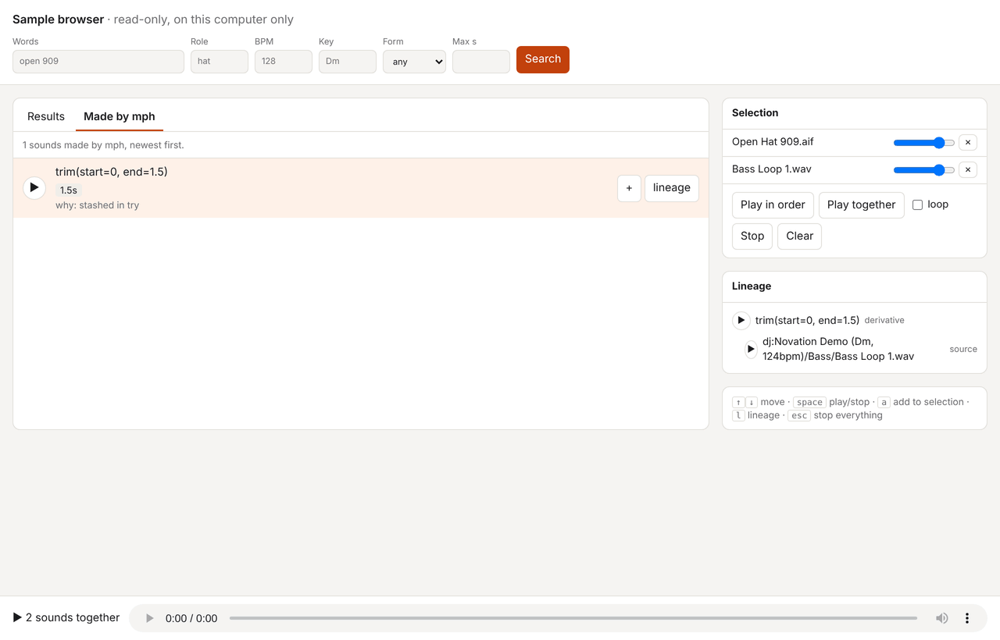
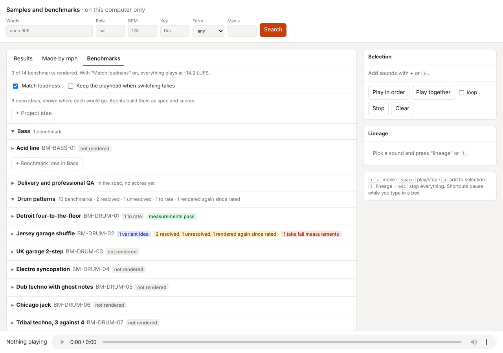
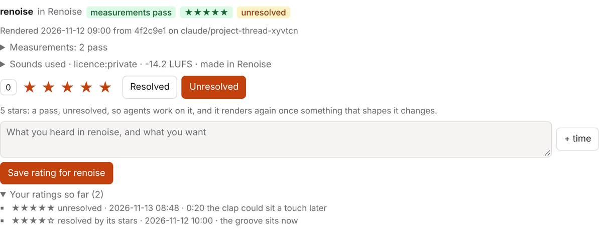
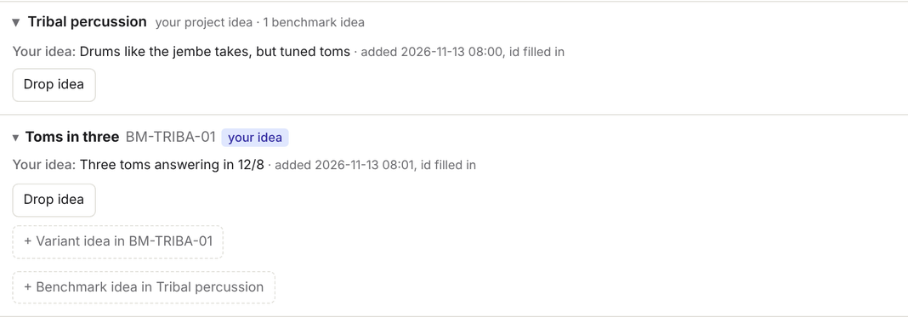

# Getting started

This page takes you from a fresh Mac to hearing Dean's example projects, and
then to projects of your own. It assumes a Mac like Dean's
([reference-mac.md](reference-mac.md)): Apple Silicon, macOS, and some free
disk space. mph runs on macOS only; the code checks also run on Linux
(`scripts/cloud-check`).

Everything below is safe to run more than once. mph never writes inside your
sample folders, keeps its own files in one data folder, and keeps passwords
and API keys in the macOS Keychain only.

## 1. Install the tools

Install [Homebrew](https://brew.sh) first, then:

```sh
brew install uv git
git clone https://github.com/dnk8n/music-production-harness.git
cd music-production-harness
uv sync
uv run mph doctor
```

`mph doctor` lists every tool mph uses, whether it's installed, and how to
install what's missing. `uv run mph install NAME` prints the steps for one
tool, and `--yes` runs the ones that can run unattended.

| Tool | Needed for | Install |
|---|---|---|
| FFmpeg | reading every sound's format and tags | `mph install ffmpeg --yes` |
| SoX | the one conversion to 48 kHz / 24-bit at delivery | `mph install sox --yes` |
| SuperCollider 3.13+ | synth sounds, and every SuperCollider take | `mph install supercollider --yes` |
| Renoise 3.5+ | Renoise takes, songs you can open and change | licensed app; `mph install renoise` says where |
| sc3-plugins | extra filters some synths use | `mph install sc3-plugins` (by hand) |
| Demucs | separating a song into stems, for remixes | `mph install demucs --yes` |
| Surge XT | the free synth in the Renoise template | `mph install surge-xt --yes` |
| LuaJIT | the Renoise bridge's tests, for developers | `brew install luajit` |
| Ollama, gh, Tidal, UVR | optional extras | see `mph doctor` |

Renoise is the one paid tool. Without it, benchmarks render in
SuperCollider alone (REQ-BEN-10), and a take that only Renoise can make says
so instead of rendering.

## 2. Configure

mph reads `~/.config/mph/config.toml` (or the file in `MPH_CONFIG`, or
`--config FILE`). Start from [config/example.toml](../config/example.toml):

```sh
mkdir -p ~/.config/mph
cp config/example.toml ~/.config/mph/config.toml
```

Then point `[[sources]]` at your own sample folders, one table per folder.
No samples yet? Delete the `[[sources]]` table: every drum then plays a
SuperCollider synth, and step 6 can download free sounds. Dean's own config,
the one the examples were made with, is
[examples/config/dean.toml](../examples/config/dean.toml).

`[projects]` decides which of Dean's example projects you see:

```toml
[projects]
examples = true                       # all of them (the default)
# examples = false                    # none: a clean slate
# examples = ["drum-patterns", "sidechain"]
folders = ["~/Music/mph-projects"]    # your own projects, if any
```

`uv run mph status` shows the result on one screen.

## 3. Build the catalogue

```sh
uv run mph catalogue scan      # index every source (read-only, incremental)
uv run mph catalogue analyse   # tempo, key, loudness, form; cached
uv run mph catalogue stats
uv run mph catalogue browse    # search, play and layer sounds in a browser
```

The scan reads file names, folders and what each file says about itself
(tags, loop and sampler chunks) as labels, and the analysis measures the
rest. A first scan and analysis of a library like Dean's (about 4,000
sounds) takes a while; later runs only look at what changed.



## 4. Credentials (optional)

Freesound gives free sounds for placeholders and downloads. Make an app at
<https://freesound.org/apiv2/apply/>, then:

```sh
uv run mph secrets set freesound          # asks for each field, says where it is
uv run mph catalogue auth freesound       # once, in a browser: original files
uv run mph secrets list                   # what's set, never the values
```

Without the browser sign-in, Freesound gives its OGG previews instead of
the original files. The Internet Archive needs no
keys. `mph secrets set gemini` adds an optional AI reviewer, which falls
back to a local Ollama model.

## 5. Look through the example projects

Dean's projects ship with the repo in [examples/projects/](../examples/projects/),
as text only: scores, a `project.toml` and a README that says what Dean
heard and decided. No sounds or renders are in the repo.

```sh
uv run mph projects list
uv run mph projects show north-star
```

```text
  on     bass                                  1 benchmark  Bass  (example)
  on     delivery-and-professional-qa          0 benchmarks  Delivery and professional QA  (example)
  on     drum-patterns                        10 benchmarks  Drum patterns  (example)
  on     effects                               0 benchmarks  Effects  (example)
  on     love-train-remix-1-detroit-x-jersey   5 benchmarks  Love Train remix 1: Detroit x Jersey  (example)
  on     north-star                            2 benchmarks  North star  (example)
  on     sidechain                             1 benchmark  Sidechain  (example)
  on     vocals                                0 benchmarks  Vocals  (example)
19 benchmarks on.
```

A project with no benchmarks yet holds a plan: `mph projects show` lists the
benchmarks its spec section describes that have no score yet.

## 6. Fill what your library lacks

The scores ask for sounds by role (a kick, a closed hat, a breakbeat loop)
and pick the best match from your catalogue. Where your catalogue has none,
a drum plays a SuperCollider synth instead, and a few voices can't play at
all (a ride, a breakbeat). `mph projects fill` shows what is missing, and
with `--yes` downloads free placeholders for it:

```sh
uv run mph projects fill                  # the list; downloads nothing
uv run mph projects fill --yes            # Freesound, 2 sounds per missing kind
uv run mph projects fill drum-patterns --yes --from archive --limit 3
uv run mph catalogue credits              # who made each sound, and its licence
```

It makes one search per missing kind of sound, takes only CC0, public domain
and CC-BY sounds of the right length, labels each with the role it was found
for, and analyses it so the next render finds it. CC-BY sounds need their
credit if you ever publish a render. Recordings can't be replaced by a
placeholder: the Love Train remix plays stems of a commercial song, and its
README says how to make them from your own copy.

## 7. Render and listen

```sh
uv run mph renoise install           # once (and after updates); then restart Renoise
uv run mph bench list
uv run mph bench render BM-DRUM-01   # every take of one benchmark
uv run mph bench render --all        # everything that's on; skips resolved takes
uv run mph bench serve               # the listening page
```

Each render is measured (timing to the millisecond, swing, chokes, loudness,
a second render that must match bit for bit) and delivered as a 48 kHz /
24-bit AIFF. Renoise takes are Renoise songs you can open from the page and
change by hand. mph refuses to render while a Renoise it didn't start is
open, so save and quit yours first.



On the page you rate each take 0 to 5 stars (3 or more is a pass) and mark
it resolved or unresolved, with notes. A resolved take renders again only
with `--force-rerender`; an unresolved one renders again once its score, the
render code or its sounds change, and agents find it through the `feedback`
tool (step 9).



You can also add ideas there: a new project, benchmark or take, which an
agent can then build.



Your takes won't sound like Dean's: the scores pick from your sounds, not
Dean's. The measurements still have to pass. Your ratings and ideas live in
your catalogue (`catalogue.sqlite` in the data folder) and nowhere else, so
back that file up.

## 8. Start your own projects

A project is a folder with a `project.toml` and one score per benchmark
([spec/components/projects.md](../spec/components/projects.md)):

```sh
mkdir -p ~/Music/mph-projects
uv run mph projects copy drum-patterns --to ~/Music/mph-projects
```

Add the folder to `[projects].folders`, change the copy, and render it. A
copy keeps the example's benchmark ids, so mph uses your copy instead of
Dean's; rename a score file and the `id` inside it to keep both. To start
from nothing, write a `project.toml`:

```toml
name = "My grooves"
about = "What this project is for."
needs = "What it needs that the repo can't hold, or nothing."
```

and a score next to it, named after its benchmark id plus `.toml`. An id
has the same form as Dean's BM-DRUM-01: `BM`, two to five capital letters
and two digits, joined by dashes. The score format is in
[spec/components/benchmarks.md](../spec/components/benchmarks.md), and the
scores in `examples/projects/` show every feature. Set `examples = false` to
see only your own.

## 9. Let Claude help

```sh
uv run mph mcp install    # once: read-only tools for every Claude Code session on this Mac
```

Claude Code sessions on the Mac can then look up sounds, labels,
benchmarks, renders, your ratings and ideas, and health, without being able
to change anything. In this repo, Claude follows [CLAUDE.md](../CLAUDE.md)
and the skills in [.claude/skills/](../.claude/skills/). The docs say
"Dean" because it is Dean's repo; on your own Mac, read it as you.

## Where things are

| What | Where | Kept by |
|---|---|---|
| Spec, code, tests, docs, example projects | this checkout | git |
| Your config | `~/.config/mph/config.toml` | you |
| Your own projects | the folders in `[projects].folders` | you (a git repo of your own works well) |
| Catalogue, ratings and ideas | `<data_dir>/catalogue.sqlite` | you: back it up |
| Downloads, cache, stashes | `<data_dir>/downloads/`, `cache/`, `stashes/` | mph; rebuildable |
| Renders and their reports | `<data_dir>/renders/` | mph; only the newest of each take |
| Renoise jobs and scratch songs | `<data_dir>/renoise/` | mph; throwaway |
| Passwords and API keys | the macOS Keychain | `mph secrets` |
| Logs of the Mac checks | `~/Library/Logs/mph/` | mph |

`data_dir` is `~/Library/Application Support/mph` unless your config says
otherwise. `uv run mph prune` shows what can be freed and deletes nothing;
`--yes` deletes it (cached stems included, which take minutes to make
again).
